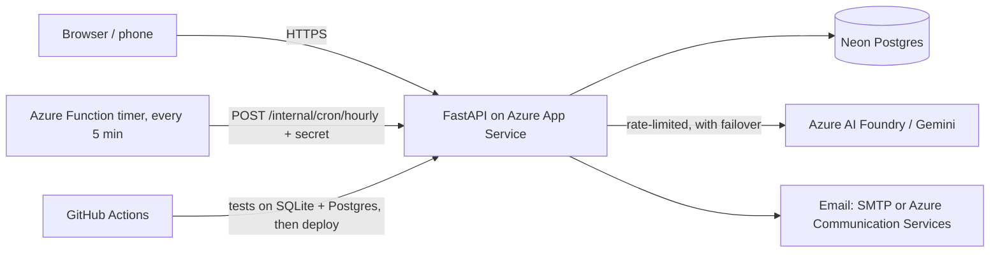

# AI Execution Planner

**Live demo:** https://YOUR-APP.azurewebsites.net &nbsp;·&nbsp; click **Try the demo**, no signup needed

Most to-do apps let you pile 14 tasks onto a 6-hour day. This planner does something different. It
turns goals into tasks (optionally using an LLM on Azure AI Foundry or Google Gemini), works out how much free time you actually have
around your calendar, and builds a realistic, energy-aware schedule. When you skip something, it
replans on its own.


## Features

- **Plan a goal by chatting about it.** Type "Read Atomic Habits", "Gym 4 days a week" or "Pass the
  GRE in March", and the planner asks a few follow-up questions, then proposes a plan to accept or adjust.
  - **Books:** looks up the page count (Google Books, Open Library), asks how fast you read, which days
    and when, then schedules page ranges ("pages 41–60") on those days and shows the finish date.
  - **Fitness:** asks what you train on which days ("Mon legs, Wed upper body") and how long. A fixed gym
    time becomes busy time in your week; flexible workouts become repeating sessions.
  - **Courses, exams, habits:** lessons per week, topics then revision rounds and mock tests, or a daily habit.
  - Runs on any chat model on **Azure AI Foundry** or **Google Gemini**. Without AI (or after the daily
    limit) the same chat runs on built-in questions. The schedule itself is always computed in code, so
    the numbers are right.
- **A week that isn't the same every day.** Office on weekdays and the 2nd and 4th Saturday, gym only on
  days you say you're going, days off and leave, "not today" for any routine. If your days vary, the
  planner doesn't plan ahead: each morning it asks how the day looks (a usual day, busy so keep it light,
  or a day off), in the app or with one tap in the morning email, and plans that day only.
- **Interactive day timeline.** Busy time, planned blocks coloured by energy and a live "now" line. Click
  the timeline to block out time, and it asks whether that's a regular thing. A focus timer records how
  long tasks really take.
- **Calendar-aware, energy-aware scheduler.** Fits work into free time, honours each task's preferred
  time of day and allowed days, splits big tasks, respects dependencies, and learns from actual vs
  estimated time.
- **Automatic replanning.** Skipping a task bumps its urgency and replans the day.
- **Goal risk detection.** Flags goals that would need more than 3 h/day to hit their deadline.
- **Personal emails.** A morning plan (or the morning check-in) at the time each person picks, an evening
  heads-up only when a goal is slipping, and on Sundays a few **books and Substack newsletters** related
  to their goals. Suggestions are filtered hard for explicit or sensual content, and newsletters are
  checked to really exist. Sent from a no-reply address with Azure Communication Services.
- **Multi-user.** Email/password accounts, confirmed email addresses, per-user data isolation, guest
  sandboxes deleted after 24 h, one-click unsubscribe, and account deletion.

## Architecture



| Module | Responsibility |
|---|---|
| `app/planner.py` | Scheduling engine: capacity, energy windows, urgency scoring, task splitting, replanning, risk |
| `app/ai_decompose.py` | Provider adapters (Azure AI Foundry v1 API, Gemini API) with failover, robust JSON parsing, output sanitising, per-user and global daily metering, template fallback |
| `app/auth.py` | Signup/login/demo, bcrypt, session cookie, IP rate limiting, timezone helpers |
| `app/goal_chat.py` | Goal planning chat: AI engine and built-in question script, answer parsing, deterministic plan builder per goal type |
| `app/routines.py` | Routines (weekday and nth-week-of-month rules, "only when I go"), day status (usual, light, off), busy time per date |
| `app/books.py` | Book lookup (Google Books, Open Library), similar books with content filtering, verified Substack suggestions |
| `app/jobs.py` | Idempotent 5-minute job: per-user morning time, parallel sending under per-minute/per-hour limits, retry on 429, guest cleanup |
| `app/mailing.py`, `app/emailer.py`, `app/email_templates.py` | Signed confirm/unsubscribe links, email routes, provider adapters (SMTP, Azure Communication Services), HTML + text templates |
| `app/main.py` | REST API (OpenAPI docs at `/docs`), ownership checks, quotas, security headers |
| `azure_function/` | Timer trigger that calls the web app every 5 minutes |

**Design decisions**

- **External timer instead of an in-process scheduler.** Free-tier web apps sleep, and multiple
  workers would duplicate jobs. A 5-minute tick plus `last_*_run` dates makes the jobs
  idempotent and timezone-correct.
- **AI cost control.** Usage is reserved before the API call so parallel requests can't exceed the
  cap, and it's refunded if the call fails. The model's output is treated as untrusted and
  clamped/validated.
- **Email safety.** Scheduled mail only goes to confirmed addresses, so nobody can sign up with someone
  else's address and spam them. Unsubscribe links are signed, and a plain GET never unsubscribes, so mail
  scanners can't do it by accident.
- **Security.** Every row lookup is scoped to the session user (404 rather than 403, so other
  users' IDs are never confirmed). Output in the dashboard is HTML-escaped. There are SameSite
  cookies, login/signup rate limits, and per-user row quotas so a free database can't be filled up.

## Run locally

```bash
python -m venv .venv && source .venv/bin/activate    # Windows: .venv\Scripts\activate
pip install -r requirements-dev.txt
cp .env.example .env        # optional: add your Azure AI Foundry and/or Gemini keys
uvicorn app.main:app --reload
```

Open http://localhost:8000. Data goes into a local `planner.db` SQLite file. Locally, the scheduled
job runs inside the app, so there's nothing else to set up.

With Docker instead: `docker build -t planner . && docker run -p 8000:8000 planner`

## Tests

```bash
pytest -q                                              # SQLite
TEST_DATABASE_URL=postgresql://user:pw@localhost/test pytest -q   # Postgres
```

69 tests cover the planning chat (both engines), routines and days off, auth, cross-user isolation, AI providers, failover, limits and fallback, email (confirmation, preferences, unsubscribe, rate limits, parallel sending, 429 retry, bounces, SMTP), the scheduler, input validation,
cron auth and idempotency. CI runs them against both SQLite and Postgres on every push.

## Deploy

Two ways, both in `docs/`: **[DEPLOY_AZURE_PORTAL.md](docs/DEPLOY_AZURE_PORTAL.md)** (Azure portal + Azure DevOps Pipelines, `azure-pipelines.yml`) or **[DEPLOY_AZURE.md](docs/DEPLOY_AZURE.md)**: App Service (free tier) + Neon Postgres +
an Azure Functions timer, with GitHub Actions deploying on every push to `main`.

## AI providers

Configure one or both with environment variables (see `.env.example`). Without any, goals get a
5-step template breakdown instead.

| Provider | Settings |
|---|---|
| Azure AI Foundry (any deployed chat model) | `AZURE_AI_ENDPOINT`, `AZURE_AI_API_KEY`, `AZURE_AI_DEPLOYMENT` |
| Google Gemini | `GEMINI_API_KEY`, optional `GEMINI_MODEL` (default `gemini-flash-latest`) |
| Order / failover | `AI_PROVIDER=azure,gemini` (default) or `gemini,azure`, `azure`, `gemini`, `none` |

## Email

Sent with **Azure Communication Services** from a no-reply address. See
**[docs/EMAIL_AZURE.md](docs/EMAIL_AZURE.md)** for setup, your own domain and higher limits.

| Setting | Purpose |
|---|---|
| `ACS_CONNECTION_STRING`, `EMAIL_FROM` | Azure resource and no-reply sender |
| `EMAIL_RATE_PER_MINUTE`, `EMAIL_RATE_PER_HOUR` | your Azure sending limits; the scheduler never goes over them |
| `EMAIL_CONCURRENCY` | parallel sends (default 4) |
| `EMAIL_EVENTS_KEY` | secret for the Event Grid bounce webhook at `/email/events` |

Any SMTP server also works (`SMTP_HOST`, `SMTP_PORT`, `SMTP_USERNAME`, `SMTP_PASSWORD`), which makes
switching provider a settings change. Locally, emails are printed to the console.

## Roadmap

- Google/Outlook calendar sync (OAuth) in place of manual busy blocks
- Alembic migrations (the schema is currently created with `create_all`)
- Weekly review agent, and a planner → evaluator → replan loop with an LLM critic
- Focus-mode timer, drag-to-reschedule UI
